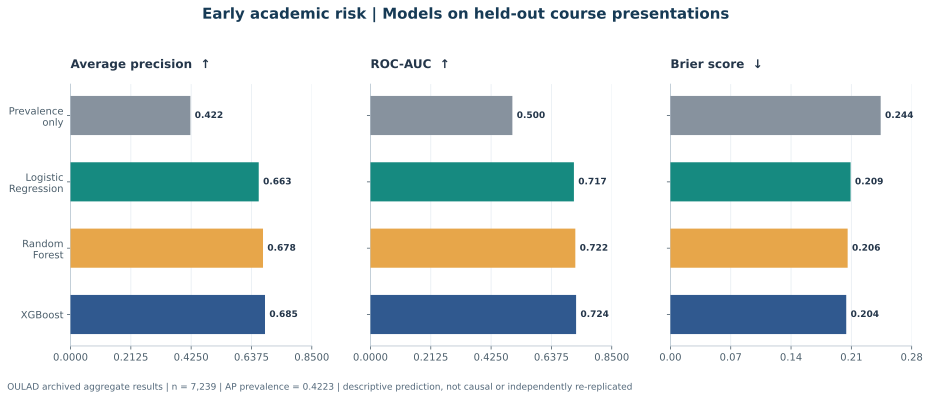
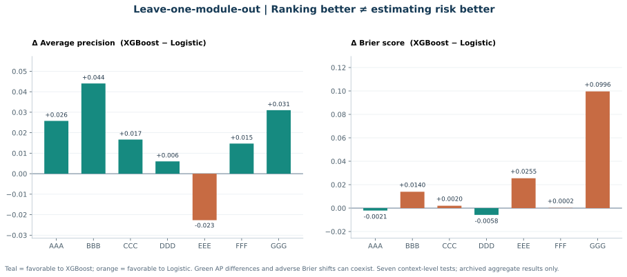

# WHEN EARLY SIGNALS TRAVEL
### Explainable Academic-Risk Prediction and Cross-Course Reliability in OULAD

**Muhammad Siddique, Ph.D.** · Applied Economist · Interdisciplinary Quantitative Researcher · Educational Data Science

   

> **Research question:** Can the first 28 days of digital learning activity anticipate later academic risk, and will model accuracy and probability reliability survive transfer to unfamiliar courses?

> **Evidence status — October 2026:** The repository contains **archived aggregate tables reported from authentic 2013–2014 OULAD analyses**, alongside reproducible research code. **24,835 distinct learners** were retained in the reported day-28 cohort, including **7,239 learners** in the main held-out test. These archived tables have been checked for basic internal consistency; an independent source-data-to-results rerun **has not been completed in this revision**. This is an **unreviewed working research project**, not a published paper, randomized intervention, or deployed student-risk system. Synthetic fixtures are software tests only.

## Abstract

This study combines observational Econometrics, supervised Machine Learning, and Explainable Artificial Intelligence to examine early academic risk using the Open University Learning Analytics Dataset. Prediction features cover course days 0–27 and recorded baseline characteristics; the target is subsequent Fail/Withdrawn status conditional on still being enrolled at day 28. Course presentations—not individual rows—are withheld during the primary evaluation, and overlapping students are excluded from training. In committed results, XGBoost achieves **0.6852 Average Precision**, compared with **0.6631** for L2 Logistic Regression, a modest **0.0221-point advantage**. Brier scores are **0.2041** and **0.2091**, respectively. Yet Logistic Regression has better Brier performance in **five of seven leave-one-module-out comparisons**, demonstrating the fragility of conclusions based on one split. Adjusted engagement associations and held-out model explanations complement the prediction audit, but do not establish causal effects. The central contribution is an **explicit assessment of portability, calibration-related error, and responsible interpretation**.

## Main held-out findings

| Metric, test n = 7,239 | XGBoost | L2 Logistic Regression | Prevalence baseline |
|---|---:|---:|---:|
| Average Precision ↑ | **0.6852** | 0.6631 | 0.4223 |
| ROC-AUC ↑ | **0.7245** | 0.7168 | 0.5000 |
| Brier score ↓ | **0.2041** | 0.2091 | 0.2440 |
| Log loss ↓ | **0.5935** | 0.6064 | 0.6812 |

The holdout's observed risk prevalence was **42.23%**. Random Forest scored AP **0.6782**, ROC-AUC **0.7218**, and Brier **0.2057**. The values above are drawn from the [committed model table](results/primary_models.csv); they are not freshly estimated for this documentation update.

*Both figures are derived strictly from committed, aggregate, reported real-data tables. Higher AP/AUC and lower Brier are preferable. Brier assesses overall probabilistic accuracy; calibration itself requires additional diagnostics.*

**Research documentation:** [Results and Discussion (APA-style)](docs/RESULTS_AND_DISCUSSION_APA7.md) · [Analysis Protocol](docs/ANALYSIS_PROTOCOL.md) · [Model Card](docs/MODEL_CARD.md) · [Reproducibility Audit](docs/REPRODUCIBILITY_AUDIT.md) · [APA 7 References](docs/REFERENCES_APA7.md).

## Research design and questions

| Question | Method | Scope of inference |
|---|---|---|
| **RQ1. Engagement and academic risk** | Adjusted Linear Probability Model, HC3 inference; separately archived clustered intervals | Observational associations, **not** effects of studying more |
| **RQ2. Predictive uplift** | Prevalence, L2 Logistic Regression, Random Forest, tuned XGBoost | Held-out accuracy for historical OULAD |
| **RQ3. Transportability** | Leave-one-module-out, chronological transfer, repeated course splits, 14/42-day sensitivity | Stability across recorded settings, not proven real-world transport |
| **RQ4. Explainability and equity** | Tree SHAP, behavior-only ablation, subgroup reporting with minimum cell sizes | Predictive reliance and diagnostics, **not** causal/fairness certification |

- **Cohort:** one eligible learner–module–presentation record per anonymized learner; enrolled at day 28, excluding those already withdrawn.
- **Timing:** features are restricted to course days **0–27**; outcome is eventual Fail/Withdrawn versus Pass/Distinction.
- **Safeguards:** no later VLE events, final grade, subsequent withdrawal dates, or assessment scores with uncertain availability enter the prediction features.
- **Validation:** hold out whole course presentations; prevent person overlap across train and test; fit transformations only on training data and select XGBoost hyperparameters with group-based inner validation.
- **Metrics:** primary Average Precision; secondary ROC-AUC, Brier and log loss. No institutional action threshold is estimated or justified.

~~~mermaid
flowchart TD
  A["Official OULAD, 2013–2014"] --> B["Eligible day-28 analytic cohort"]
  B --> C["Presentation-held-out validation"]
  C --> D["Econometric associations"]
  C --> E["Logistic, Forest and XGBoost"]
  E --> F["Prediction and transfer"]
  E --> G["Held-out SHAP and subgroup diagnostics"]
  D --> H["Results and limitations"]
  F --> H
  G --> H
~~~

## Five defensible findings

1. **Modest uplift, not definitive superiority.** XGBoost exceeds Logistic Regression by **0.0221 AP points** on the primary holdout, without establishing independent-sample statistical significance.
2. **Model choice changes across courses.** XGBoost has higher AP in six of seven module holdouts, whereas Logistic Regression has lower Brier error in five; on module GGG Brier error is **0.3749** versus **0.2753**, respectively.
3. **Engagement predicts; causation remains unidentified.** Negative adjusted coefficients for recorded early clicks, active days and submissions can also reflect prior preparation, motivation, and other unmeasured influences.
4. **Removing background predictors incurs a measured performance cost.** Behavior-only XGBoost AP is **0.6029** compared with **0.6852** for all features. Neither feature set has been established as fair or suitable for high-stakes use.
5. **Later cutoffs use different learners.** Day-14 and day-42 analyses change the eligible population; resulting differences are not the causal impact of delaying support.

**Not studied:** Robotic Teaching Assistants; generative-AI tutors; human interventions after warnings; randomized treatments; prospective adoption or contemporary U.S. student outcomes.

## New research extension: Decision reliability under limited support capacity

**Added methodological capability — no new empirical results claimed.** The [Reliability-Aware Decision Audit](docs/DECISION_RELIABILITY_EXTENSION.md) adds a reproducible, post-hoc evaluation of the locally generated held-out predictions. It investigates whether a high AP model is also preferable when a college can contact only a limited share of students.

| Additional analytical question | Implemented, testable output |
|---|---|
| How many at-risk learners might fall in the highest-ranked 5%, 10% or 20%? | Expected PPV, recall and lift with **tie-aware** boundary selection |
| Are predicted probabilities quantitatively credible? | Diagnostic calibration intercept/slope and suppressed-small-cell reliability bins |
| Does the ranking depend on individual course context? | Per-presentation descriptive metrics and a paired **presentation-cluster bootstrap** |
| Can the results be disclosed ethically and reproduced? | Aggregate-only exports, input SHA-256, strict real-versus-synthetic manifest checks, deterministic tests |

The new audit does **not** claim to determine which learners would benefit from support, establish fairness, or measure any intervention effect. Similar capacity-aware OULAD evaluation has already been published; the present value is a transparent extension to the repository's existing econometric and transportability analyses. See the [three-track research roadmap](docs/RESEARCH_EXTENSION_ROADMAP.md) for the next scientific questions and their limitations.

After separately obtaining official OULAD data and running the empirical pipeline below, the extension is:

~~~bash
python -m src.decision_audit --predictions outputs/real_oulad/holdout_predictions.csv --output-dir outputs/real_decision_audit
~~~

It requires the empirical module's companion manifest and will refuse to relabel synthetic predictions as real research results. Detailed methods and a **separately labeled fictional test workflow** appear in [the extension protocol](docs/DECISION_RELIABILITY_EXTENSION.md).

## Data provenance and ethics

The original Open University dataset contains **32,593 student-course registrations**, **22 course presentations** and **10,655,280 VLE activity records**. Those totals are from the **source**, not the filtered analytic cohort.

- [Original Open University source](https://research.stem.open.ac.uk/ouanalyse/dataset/) · [Original Figshare deposit](https://doi.org/10.6084/m9.figshare.5081998) · [UCI accession](https://doi.org/10.24432/C5KK69).
- [Kuzilek, Hlosta, and Zdrahal (2017), original data descriptor](https://doi.org/10.1038/sdata.2017.171) · [Original dataset license: CC BY 4.0](https://creativecommons.org/licenses/by/4.0/).
- Preserved archive SHA-256 from project log: **f2ed1902616c1fe8d2824d872c0b7d2d72be435bf0124d077044fe4be2c6d3e4**. Its source-file correspondence was **not rechecked** in this documentation revision.
- Raw learner-level tables and predictions are excluded from version control. **MIT** governs new repository code; it does not replace the dataset creators' license.

## Reproduction

Python 3.11+; research software checks are separate from independent confirmation of the archived empirical coefficients.

~~~bash
python -m venv .venv
# PowerShell: .\.venv\Scripts\Activate.ps1
# macOS/Linux: source .venv/bin/activate
python -m pip install -r requirements.txt
python -m pytest -q

# Audit committed aggregate numbers and regenerate safe-to-share SVG figures:
python -m scripts.audit_published_results
python -m scripts.build_published_figures
~~~

To rebuild the underlying cohort and models, obtain the seven original OULAD tables in the locally excluded data/raw folder:

~~~bash
python scripts/download_official_oulad.py --destination data/raw
python -m src.prepare_oulad --data-dir data/raw --output data/processed/oulad_day28.csv --cutoff-day 28
python -m src.empirical --input data/processed/oulad_day28.csv --output-dir outputs/real_oulad
python -m src.robustness --input data/processed/oulad_day28.csv --output-dir outputs/real_robustness
~~~

These commands provide a workflow **but do not independently prove exact agreement with every archived table**, including the separately reported clustered standard errors. See the [honest verification ledger](docs/REPRODUCIBILITY_AUDIT.md).

## Research library

| Evidence | Research artifacts |
|---|---|
| Academic reporting | [APA-style Results and Discussion](docs/RESULTS_AND_DISCUSSION_APA7.md) · [Original APA 7 References](docs/REFERENCES_APA7.md) · [Working Paper Status](manuscript/WORKING_PAPER_STATUS.md) |
| Methods | [Analysis Protocol](docs/ANALYSIS_PROTOCOL.md) · [Data Dictionary](docs/DATA_DICTIONARY.md) · [Official Sources](docs/OFFICIAL_DATA_SOURCES.md) |
| Responsible research | [Model Card](docs/MODEL_CARD.md) · [Reproducibility Audit](docs/REPRODUCIBILITY_AUDIT.md) · [Research Integrity](docs/RESEARCH_INTEGRITY.md) |
| Evidence files | [Aggregate Table Guide](results/README.md) · [Primary Models](results/primary_models.csv) · [Cross-Module Transfer](results/leave_one_module_out.csv) · [Figures](figures/) |
| Code and tests | [Cohort Builder](src/prepare_oulad.py) · [Empirical Models](src/empirical.py) · [Robustness](src/robustness.py) · [Tests](tests/) |
| Advanced research extensions | [Decision Reliability Protocol](docs/DECISION_RELIABILITY_EXTENSION.md) · [Research Roadmap](docs/RESEARCH_EXTENSION_ROADMAP.md) · [Decision Audit Code](src/decision_audit.py) |

**Status:** Unreviewed, observational working research, not a deployed service. Citation of this repository as research software is described by [CITATION.cff](CITATION.cff); cite the OULAD authors separately. No score should be used to penalize or exclude a learner. Responsible applications require new-cohort validation, credible fairness and calibration audits, student protections, human oversight and evidence that support programs help rather than harm.

---
*Rigorous Educational AI must be accurate, transportable, transparent about uncertainty, and accountable to learners.*
